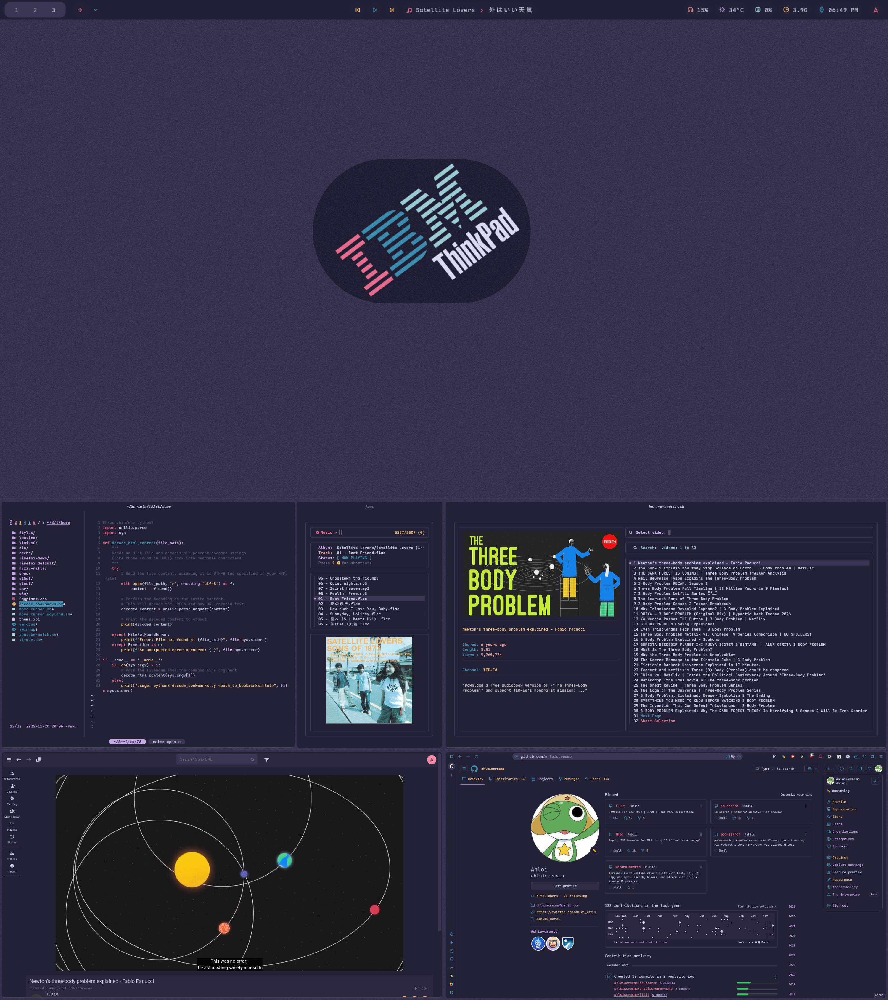

# Ahloi Dotfiles

My personal dotfiles for Artix Linux with runit, ScrollWM on Wayland, and i3wm on X11.

## Boot and desktop

```text
Limine (bootloader)
└── Artix Linux (runit)
    └── Ly (login)
        ├── ScrollWM / Wayland (default)
        └── i3wm / X11
```

| Desktop component | Wayland | X11 |
| --- | --- | --- |
| Status bar | Waybar | Polybar |
| Image viewer | Swayimg, imv | nsxiv, feh |
| GTK appearance | nwg-look | LXAppearance |
| Input automation | ydotool | xdotool |

## Daily programs

| Role | First choice | Alternatives |
| --- | --- | --- |
| Launcher | Rofi | bemenu, fsel |
| Terminal | kitty + `kitty_grab` | Alacritty + tmux |
| File manager | nnn + `nuke` + `preview-tui` | Yazi, CliFM, Thunar |
| Web browser | Firefox + Tridactyl | Chawan, w3m |
| Local music | FMPC | cmus, MPD + ncmpcpp, nnn + MOC |
| Online video | `keroro-search` | Ytsurf, FreeTube |
| Anime | ani-cli | Curd, GoAnime |
| Music streaming | Spotify + Spicetify | Cliamp, YTM |
| Podcasts | Podliner + `pod-search` | — |

## Media and reading

| Role | Tools |
| --- | --- |
| Video playback | mpv, ffplay |
| Media processing | FFmpeg |
| Photo browsing | gThumb |
| Audio mixing | alsamixer, Wiremix, pwvucontrol |
| Audio tagging | Kid3 |
| Screenshots | grim |
| Screen recording | wf-recorder |
| Screen region selection | slurp |
| E-books | Lue, epy |
| PDFs and comics | Zathura + `zathura-cb` |
| Digital art | Krita, Inkscape |

## Editing and online tools

| Role | Tools |
| --- | --- |
| Text editing | Vim, vi, gVim |
| Coding agents | Codex CLI, Antigravity (`agy`) |
| Note-taking | Notes |
| Typing practice | TypeRacer |
| Messaging | Telegram |
| Internet Archive search | `ia-search` |
| Hacker News | Clx |
| Gemini browsing | Amfora, Chawan |
| Downloads and peer-to-peer | yt-dlp, gallery-dl, qBittorrent, Nicotine+ |
| File transfer | LocalSend, ADB |
| Android screen mirroring and control | scrcpy |

## Input, appearance, and maintenance

| Role | Tools and settings |
| --- | --- |
| Keyboard-driven pointer control | Fievel, warpd, Hints, wl-kbptr, built-in ScrollWM/Sway controls |
| Key remapping | keyd |
| Default font | Maple Mono |
| Font browsing and previews | Gucharmap, Fontpreview |
| Qt appearance | qt4ct, qt5ct, qt6ct |
| Color scheme | Rosé Pine Moon with a softer `#c8c8e5` foreground in parts of the setup, plus Rosé Pine Dawn for daylight |
| System monitoring | htop, top |
| Cleanup | BleachBit CLI |
| Compressed swap | Zramen |
| SSD discard | fstrim |

The [theme-switching script](local/bin/scroll-night.fish) applies the Rosé Pine variants across the desktop and apps.

## Enabled runit services

| Role | Services |
| --- | --- |
| Login and sessions | `agetty-tty1`, `agetty-tty3` through `agetty-tty6`, `ly`, `logind` |
| System and devices | `dbus`, `udevd`, `wacom-reload`, `ydotoold` |
| Networking and time | `dhcpcd`, `ntpd` |
| Scheduling | `cronie` |
| Memory and swap | `earlyoom`, `zramen` |

## Screenshots


